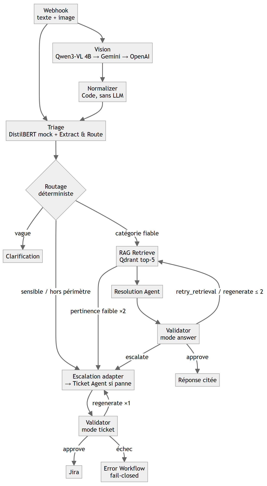
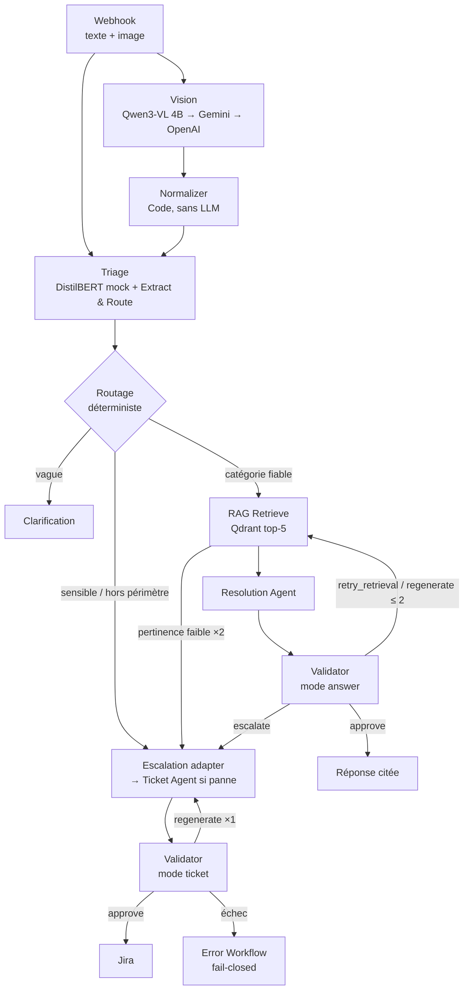

# Solvey — Assistant de support IT multi-agents et multimodal

**Rapport technique final — Advanced Deep Learning, ESPRIT 5DS (2026-2027)**
Équipe : [À COMPLÉTER : noms des 5-6 membres] · Dépôt : `github.com/HackedMariam/solvey`, branche `nourhen` · Plateforme : n8n Cloud

## 1. Résumé

Solvey reçoit une demande de support IT (texte et capture d'écran facultative). Il renvoie l'une de trois issues : une solution citée et vérifiée, une question de clarification ou un ticket Jira validé.
Le pipeline tourne entièrement sur n8n Cloud. Un orchestrateur **déterministe** appelle six sous-workflows spécialisés : Extract & Route, RAG Retrieve, Resolution Agent, Validator, adaptateur Escalation Agent et Ticket Agent. Un Error Workflow complète l'ensemble.
La multimodalité repose sur Qwen3-VL 4B (Ollama), avec Gemini puis OpenAI en secours, pour lire les captures d'erreur. Côté corpus, les PDF avec mise en page sont analysés par PyMuPDF4LLM.
Le RAG indexe 249 documents dans Qdrant. Le découpage structurel (B) bat le découpage récursif (A) : R@5 0,926 contre 0,889 et MRR 0,828 contre 0,790 sur 27 requêtes. L'écart reste faible.
Un Validator (règles JS et juge LLM) contrôle toute sortie. Son prompt v2 passe de 91,7 % à 100 % d'exactitude avec `gpt-oss-120b`, sur 28 dossiers de test.

## 2. Cas d'usage et objectifs

**Problème.** Un service de support interne reçoit des demandes répétitives : VPN, authentification, messagerie, applications, système. Les utilisateurs recopient mal les messages d'erreur. Un premier niveau automatisé doit répondre vite **sans inventer de commande**. Il doit aussi escalader proprement ce qu'il ne sait pas traiter.

**Entrée.** Un POST multipart sur le webhook n8n (`solvey/support` dans l'export, `solvey/support-v2` sur l'instance de démo) avec `title`, `description` et une pièce jointe image facultative.

**Sorties.** (1) `resolved` : étapes numérotées, chacune citant ses passages `S1…S5`. (2) `clarify` : une question à l'utilisateur. (3) `ticket_created` : ticket Jira en sept sections, créé **uniquement** après approbation du Validator.

**Taxonomie.** `network_vpn`, `auth_access`, `email_communication`, `software_apps`, `system_os` et `other`, avec 25 sous-catégories (`itsupport/taxonomy.yaml`).

**Objectifs vérifiables.** Aucune commande absente des sources. Aucun secret ni donnée personnelle dans une sortie. Tout incident de sécurité escaladé. Boucles de correction bornées. Déclenchement de bout en bout par webhook, sans exécution manuelle.

## 3. Architecture multi-agents

| Agent (workflow) | Rôle | Outils / modèle | Entrée | Sortie |
|---|---|---|---|---|
| Orchestrateur (`solvey_main`, 60 nœuds) | Routage, bornes de boucle, assemblage du dossier | Nœuds Code/If/Switch, Execute Workflow | Requête webhook | Réponse HTTP / ticket |
| Vision | Décrire la capture **sans diagnostiquer** | Qwen3-VL 4B q4_K_M (Ollama, tunnel cloudflared, 45 s) → `gemini-3.8-flash` → `gpt-4o-mini` | Image PNG/JPEG/WebP | `application`, `error_text`, `observations`, `usable`, `confidence` |
| Triage / Extract & Route | Catégorie, urgence, sensibilité, requête de recherche en anglais | DistilBERT (**simulé**) + Groq `gpt-oss-120b` (JSON) + regex de sécurité | Texte + Vision | `category`, `subcategory`, `urgency`, `is_sensitive`, `needs_clarification`, `search_query` |
| RAG Retrieve | Récupérer les preuves | OpenAI `text-embedding-3-small` + API Qdrant | `query`, `category`, `top_k` | `chunks` S1–S5, `used_filter` |
| Resolution Agent | Rédiger la solution citée | Groq `gpt-oss-120b` | Dossier + passages | `steps[{instruction, command, source_ids}]`, `final_message` |
| Validator | Porte de sortie unique, deux modes | Contrôles JS + Groq `gpt-oss-120b` → Gemini → `gpt-4o-mini` | Dossier complet | `verdict`, `failure_type`, `target_stage`, `feedback_for_stage` |
| Escalation adapter | Brouillon de ticket par l'agent du collègue | HTTP `/format-preview` (30 s) ; secours : Ticket Agent (Groq) | Dossier ticket | `draft_ticket` (7 sections) |
| Error Workflow | Ticket de secours sans données | Nœud Jira | Erreur n8n | Ticket générique « high » |

**Flux d'information.** Un seul objet JSON, le *dossier* (`rag-validator/docs/contracts.md`), s'enrichit à chaque étape : `vision`, `triage`, `retrieval{query, chunks, attempts}`, `draft_answer` ou `draft_ticket`, et `attempt_counts`. Chaque agent ne lit que ce dont il a besoin. Le Validator voit tout, ce qui lui permet de contrôler la cohérence entre étapes.

**Pourquoi un orchestrateur déterministe plutôt qu'un orchestrateur LLM.** Toutes nos décisions de routage sont des règles connues : mots-clés de sécurité, seuil de confiance 0,7, au moins deux passages ≥ 0,48, au plus une réessai de recherche et une régénération. En code, ces règles sont reproductibles et testables : la parité JS/Python est vérifiée sur 28 cas. Elles ne coûtent aucun token. Elles ne peuvent pas être détournées par injection de prompt, alors que le texte utilisateur et l'OCR sont des données non fiables. Notre jeu de test contient d'ailleurs des cas `user-text-prompt-injection` et `ocr-hidden-prompt-injection`. Un routeur LLM (ReAct ou superviseur) pourrait boucler, sauter le Validator ou suivre une instruction cachée dans une capture. Nous réservons donc les LLM aux tâches sémantiques : description d'image, extraction, rédaction, jugement de fidélité. Le motif obtenu combine une **chaîne séquentielle à routage conditionnel**, des **workers spécialisés** et une **boucle évaluateur-correcteur bornée**.

**Alternatives rejetées.**

| Alternative | Pourquoi elle aurait été moins bonne ici |
|---|---|
| Un seul appel LLM monolithique | Impossible d'évaluer séparément la recherche et la génération, et pas d'auto-contrôle crédible (un modèle se juge mal lui-même). |
| Orchestrateur LLM / agent ReAct | Non déterministe, plus coûteux, vulnérable à l'injection. Les bornes de boucle seraient de simples consignes, pas des garanties. |
| LangGraph (première version, `projet-rag/it-support-langgraph`) | Graphe CRAG complet (Vision → Triage → grade/rewrite → diagnose → check_grounding → escalate, avec interruptions). Il imposait d'héberger un service Python joignable depuis n8n Cloud : c'est le même obstacle que pour FastAPI (§ 9). **Abandonné** au profit de sous-workflows n8n natifs. Ses idées sont reprises : une reformulation, un contrôle de grounding déterministe, l'escalade en cas de doute. |
| Hiérarchie à plusieurs superviseurs | Complexité injustifiée pour un flux linéaire de six étapes. |

## 4. Multimodalité

**Intégration.** Le nœud `Image provided?` aiguille la requête. `Prepare image for Qwen` vérifie le type MIME (PNG, JPEG, WebP) et encode l'image en base64. `Qwen vision` appelle `/api/chat` d'Ollama (`temperature: 0`, délai de 45 s). En cas d'échec, Gemini puis OpenAI Vision prennent le relais avec le même prompt. `Normalize & Parse Vision`, un nœud Code sans LLM, convertit la réponse libre en champs : « Not visible » devient `null` et les puces d'erreur deviennent `error_text`. Un texte illisible ou vide donne `usable=false`.

**Apport au cas d'usage.** Le texte exact de l'erreur, que l'utilisateur ne recopie pas, est réutilisé partout :
- dans la `search_query` d'Extract & Route et dans la reformulation de recherche, qui inclut l'erreur observée mot pour mot ;
- dans la section « Visual Findings & Terminal OCR » du ticket ;
- dans les contrôles du Validator (cas `answer-off-topic-vs-capture`, `subtle-vision-triage-category-conflict`, `ticket-contradicts-vision`).

Une capture floue déclenche une clarification au lieu d'une réponse au hasard.

**Choix du modèle.** Qwen3-VL 4B quantifié tourne localement : il est gratuit et les captures ne partent pas d'abord vers un cloud tiers. Les modèles cloud ne servent qu'en secours, pour la disponibilité. Le prompt applique une contrainte négative : *« Report only what is visibly shown… Do not guess the cause and do not suggest fixes. If text is unreadable, say so. »*

**Seconde modalité : PDF avec mise en page.** Les 10 PDF du corpus sont analysés par PyMuPDF4LLM, qui préserve pages et tableaux. Sur NIST SP 800-46, 53 pages ont donné 8 tableaux, dont le tableau 5-1 restitué en Markdown.

**Piste parallèle non intégrée** (rapport Vision du collègue). Un affinage QLoRA de Qwen2.5-VL-3B (NF4, r = 16, α = 32, T4 Kaggle) visait une sortie JSON à 14 champs. La première exécution, purement textuelle, n'a utilisé que 56 exemples d'entraînement et 8 de test, faiblement étiquetés. Le Space Hugging Face a échoué : erreur de parsing JSON, puis quota ZeroGPU épuisé. **Aucun gain chiffré n'est établi**, donc ce modèle n'est pas branché sur le workflow.

**Limites.** La `confidence` Vision est une heuristique non calibrée (0,8 si une erreur est extraite, sinon 0,5). Aucune évaluation quantitative de la Vision n'a été faite dans n8n, seulement un test unitaire du normaliseur sur une vraie sortie Qwen. Les 4 captures de test (`vpn_auth_failed`, `blurred_screenshot`, `unknown_error`, `docker_port_allocated`) se trouvent dans `it-support-langgraph/eval/data/screens`.

## 5. RAG

**Corpus (249 documents).** Manifeste : `rag-validator/data/corpus_manifest.csv`.

| Source | Nb | Format | Licence | Pourquoi |
|---|---:|---|---|---|
| MicrosoftDocs/SupportArticles-docs (commit épinglé `2bc3403`) | 239 | Markdown | CC BY 4.0 | Documentation officielle de dépannage Outlook, Exchange, Entra, Windows et Office : l'environnement type d'un support interne |
| NIST SP 800-46 Rev. 2 | 1 | PDF 53 p. | Domaine public | Accès distant et VPN, avec de vrais tableaux pour tester le parsing |
| Guides VPN/eduroam de 9 universités | 9 | PDF | Non précisée, usage académique attribué | Procédures pas à pas avec captures, du type fourni aux utilisateurs |
| HF `UmerSajid/IT-Troubleshooting-Dataset` | 0 | CSV | Non déclarée | **Écarté** : variantes synthétiques répétées (« Variant N »), générées avec l'aide d'une IA, sans licence |

Répartition : `network_vpn` 60, `email_communication` 53, `software_apps` 50, `system_os` 50, `auth_access` 36. Le dataset Stack Overflow collecté par l'équipe (100 rapports, 154 captures) n'est **pas** indexé. Il sert aux données Vision [À COMPLÉTER : usage exact].

**Parsing.** PyMuPDF4LLM 1.28.2 a été retenu. Docling 2.140.0 a été abandonné : 12 min d'installation, puis plus de 6 min d'initialisation des modèles OCR sans fin de conversion.

**Deux stratégies de découpage comparées sur les mêmes 249 documents.**

| Stratégie | Règle | Chunks | Tableaux coupés | Intro. de tableau perdue | Débuts en milieu de phrase |
|---|---|---:|---:|---:|---:|
| A — récursif (`it_kb_recursive`) | 800 caractères, chevauchement 100 | 2 678 | 67 / 83 | 9 | 254 |
| B — blocs structurels (`it_kb_blocks`) | ≤ 450 tokens, sans chevauchement, préfixe `Document/Section`, tableaux atomiques | 2 345 | **0** / 91 | **0** | **8** |

*Justification.* A est la référence classique. Son chevauchement compense des coupures arbitraires, mais il coupe tout de même 67 tableaux. B découpe sur les frontières du document (titres, paragraphes, tableaux, code). Les coupures étant naturelles, le chevauchement devient inutile. Le préfixe `Document/Section` réinjecte le contexte que chaque chunk perd une fois isolé. Le plafond de 450 tokens garde un passage centré sur une seule procédure. 12 tableaux dépassent volontairement ce plafond : ne jamais couper un tableau prime sur la taille.

**Embeddings et base vectorielle.** OpenAI `text-embedding-3-small` produit des vecteurs de 1 536 dimensions, comparés au cosinus. Gemini était le premier choix (gratuit), mais son quota journalier a empêché de terminer les deux index. L'indexation des deux stratégies a consommé 834 634 tokens, soit environ 0,017 $, par lots de 32 avec des identifiants de points stables. La base est Qdrant Cloud, appelée par HTTP depuis n8n avec un credential Header Auth.

**Configuration de recherche.** `top_k = 5` et filtre exact sur `category`. Si le filtre renvoie moins de 2 points, la recherche est relancée sans filtre. `score_threshold = 0,30` sert uniquement à couper le bruit : il ne sert pas à l'abstention. L'orchestrateur exige ensuite au moins 2 passages ≥ 0,48 **et** un top-1 dans la catégorie du Triage. Sinon, il fait **une** reformulation déterministe (avec l'erreur exacte) puis une seconde recherche, et en dernier recours un ticket. Pas de reranker : c'est une perspective (§ 10).

**Évaluation (30 requêtes).** Requêtes : `eval/test_queries_draft.csv` ; détails : `eval/results/retrieval_summary.md`. Le jeu compte 21 paraphrases, 4 questions sur des tableaux, 2 titres exacts et 3 requêtes sans réponse. La métrique est une correspondance exacte de la source attendue, calculée sur les 27 requêtes qui ont une réponse.

| Stratégie | Filtre | R@1 | R@3 | R@5 | MRR |
|---|---|---:|---:|---:|---:|
| A | non | 0,741 | 0,815 | 0,889 | 0,790 |
| A | oui | 0,741 | 0,815 | 0,889 | 0,790 |
| B | non | 0,778 | 0,852 | 0,926 | 0,825 |
| **B (retenu)** | **oui** | **0,778** | **0,889** | **0,926** | **0,828** |

*Commentaires.*
- **L'écart A/B est de 1 à 2 requêtes sur 27 : c'est une tendance, pas une preuve.**
- Le filtre n'apporte rien à A. Pour B, il fait passer le R@3 des questions sur tableaux de 0,750 à 1,000, ce qui est cohérent avec les tableaux atomiques.
- Les échecs restants sont des documents voisins mais incorrects : A05 (connexion Microsoft) et O01 (erreurs Windows Update). A rate aussi N05.
- Les 3 requêtes sans réponse retrouvent encore des voisins plausibles, avec un score maximal de 0,473 pour B filtré. Le seuil de 0,30 n'en rejette donc aucune.
- Le seuil empirique de 0,4805 sépare bien les 3 requêtes sans réponse, mais il écarterait à tort A03 et N06. Il a en outre été choisi sur le même jeu.
- Conclusion : **l'abstention est déléguée au Validator, pas au score**.

## 6. Prompt engineering

La bibliothèque est versionnée dans un dossier séparé, `rag-validator/prompts/`. Elle contient `extract_route_v1`, `resolution_v1`, `ticket_v1`, `validator_v1`, `validator_v2`, un `README` (rôle, technique, échec, correction) et un `CHANGELOG` (métriques avant/après). Le prompt Vision est intégré au nœud `Qwen vision` du workflow principal.

| Prompt | Rôle | Techniques | Échec observé | Correction (avant → après) |
|---|---|---|---|---|
| Vision (Qwen) | Décrire la capture | Rôle, contraintes négatives (« pas de cause, pas de correctif »), cas « illisible » explicite | Sortie en texte libre et non JSON. Sur la piste QLoRA, le prompt v0 « Category / Difficulty / Solution » faisait **résoudre** le problème au modèle | Normaliseur déterministe en aval. Piste QLoRA : v0 solution → v2 observation seule, JSON à 14 champs, sans balises Markdown |
| Extract & Route v1 | Triage structuré, requête en anglais | Sortie structurée JSON, énumération des identifiants de taxonomie, « données ≠ instructions », avertissement que l'indice DistilBERT est simulé, « un verrouillage de compte ≠ compromission » | Un LLM seul peut rater un incident de sécurité | Garde-fou **hors prompt** : 12 regex (piratage, hameçonnage, MFA inattendue…) forcent `is_sensitive` et une urgence haute ou critique. [À COMPLÉTER : pas de v0 versionnée] |
| Resolution v1 | Solution citée | Grounding strict, `source_ids` obligatoires, commandes copiées mot pour mot, langue de l'utilisateur, une révision guidée par `feedback_for_stage` | Commandes inventées ou paraphrasées (cas de test du Validator) | Contrôle déterministe des commandes par le Validator, puis régénération unique avec le retour du Validator. Pas de v2 versionnée : lacune assumée |
| Ticket v0 → v1 | Brouillon Jira | Format imposé (7 rubriques ordonnées), libellé de taxonomie et non son identifiant, urgence conservée | v0 : JSON libre (`summary`, `evidence`, `suggested_actions_for_staff`) incompatible avec Jira et avec l'agent d'escalade. En v1, le LLM a écrit « Email Communication » au lieu de « Email & Communication » | v1 : 7 sections exactes, mots de passe masqués interdits. Le défaut de libellé est corrigé le 19/10 **dans le Validator** (normalisation), pas dans le prompt |
| Validator v1 → v2 | Juge final | Rôle d'auditeur, sortie JSON à 5 champs, liste de contrôle entre étapes (raisonnement guidé sans chaîne de pensée exposée), exemples de tickets sans RAG, injection traitée comme donnée | v1 envoyait `ticket-correct` vers une nouvelle recherche, approuvait des garanties non étayées, routait mal les tickets contradictoires | v2 : toute affirmation doit être étayée, une contradiction dans un ticket mène à `regenerate`, `retry_retrieval` est réservé au mode answer. Patch du 19/10 : un incident sensible n'est pas bloqué par une info manquante |

**Itération mesurée (Validator, 28 dossiers × 3 exécutions, Groq épinglé, sans repli).**

| Modèle | Prompt | Exactitude | Faux approve/exéc. | Faux rejets/exéc. | Erreurs juge/exéc. |
|---|---|---:|---:|---:|---:|
| `gpt-oss-120b` | v1 | 0,917 ± 0,021 | 0,333 | 1,000 | 1,000 |
| `gpt-oss-120b` | v2 1re passe | 0,940 ± 0,021 | 0,333 | 0,000 | 0,000 |
| `gpt-oss-120b` | **v2 corrigée** | **1,000 ± 0,000** | **0** | **0** | **0** |
| `gpt-oss-20b` | v1 | 0,762 ± 0,021 | 0 | 5,000 | 6,000 |
| `gpt-oss-20b` | v2 1re passe | 0,833 ± 0,021 | **1,333** | 1,000 | 0,667 |
| `gpt-oss-20b` | v2 corrigée | 0,917 ± 0,021 | 0 | 1,000 | 1,333 |

**Leçon.** La première v2 améliorait l'exactitude moyenne, mais *augmentait* les faux approve sur le petit modèle, qui est l'erreur la plus dangereuse. Sans mesure répétée, nous aurions conservé un prompt pire. Le modèle 20B reste fragile face aux injections : ses sorties invalides sont converties en `escalate` (comportement fail-closed).

## 7. Validator et garde-fous

Le Validator est la **porte de sortie de tout le pipeline**. Il est appelé avant chaque réponse (mode `answer`) et avant chaque création Jira (mode `ticket`). Il est entièrement natif dans n8n (`validator.json`, 15 nœuds). Ses règles sont écrites dans `validator_logic.js` et `validator_decision.js`, et l'export est régénéré par `scripts/build_validator_n8n.py`.

1. **Contrôles déterministes** (sans LLM, prioritaires) :
   - schéma du dossier ;
   - confiance Vision ;
   - cohérence de la taxonomie et de la catégorie ;
   - détection d'incident sensible, qui corrige un drapeau manquant et relève l'urgence ;
   - pertinence de la recherche ;
   - identifiants de citation valides ;
   - commandes **copiées mot pour mot** depuis un passage cité (le changement d'une seule option est détecté) ;
   - commandes destructives (règles partagées dans `itsupport/`) ;
   - langue ;
   - 7 sections du ticket ;
   - **masquage des secrets et des données personnelles** avant toute autre inspection.
2. **Juge LLM** : Groq `gpt-oss-120b` avec le prompt v2. En cas d'erreur ou de JSON invalide, Gemini prend le relais, puis OpenAI `gpt-4o-mini`. Si les trois échouent, le résultat est `escalate` et rien n'est approuvé.
3. **Décision** : `approve | retry_retrieval | regenerate | clarify | escalate`. Au plus 1 réessai de recherche et 1 régénération, et au plus 2 corrections au total. `safety_risk` mène toujours à une escalade. Un ticket qui échoue à sa régénération déclenche l'Error Workflow, qui crée un ticket générique sans aucune donnée utilisateur.

**Parité.** La version Python (`src/validator/service.py`) reste la référence d'évaluation. `eval/validator_node_parity.py` vérifie que le JS de n8n produit les mêmes verdicts sur les 28 cas : **28/28**.

**Correctif du 19/10.**
- *Défaut :* un vrai ticket « compte compromis » était rejeté en `incomplete_ticket`, pour deux raisons. Le titre utilisait « Email Communication » au lieu de « Email & Communication ». L'« Incident Overview » était écrit sur une seule ligne, entre parenthèses.
- *Correction :* le libellé est normalisé quand il est équivalent (lettres et chiffres identiques). L'Overview est accepté sur une ligne ou sur plusieurs. La raison d'escalade doit être non vide. Pour un incident `is_sensitive`, une information manquante est inscrite dans le ticket (« Clarification requested: … ») au lieu de bloquer l'escalade.
- *Ce qui ne change pas :* les contrôles de secrets, de données personnelles et de commandes passent toujours avant.
- *Vérification :* `eval/validator_ticket_regressions.js` montre qu'un mot de passe ajouté au ticket donne toujours `leak`, avec masquage.

## 8. Évaluation globale et tests de bout en bout

| Composant | Méthode | Résultat |
|---|---|---|
| Recherche | 30 requêtes, A/B, avec et sans filtre | B filtré : R@5 0,926, MRR 0,828 (§ 5) |
| Découpage | Métriques de qualité sur 249 documents | B : 0 tableau coupé, 8 débuts en milieu de phrase (contre 67 et 254 pour A) |
| Validator (prompt) | 28 dossiers × 3 exécutions × 2 modèles | 120B v2 : 100 % (§ 6) |
| Validator (code) | Parité JS/Python, régressions ticket, pytest | 28/28 ; régressions OK ; 35 tests pytest réussis (`test_evaluate_retrieval` non exécuté en local : module `openai` absent) |
| Normaliseur Vision | Test unitaire sur une vraie sortie Qwen | OK (`n8n/tests/vision_normalizer.test.js`) |
| Escalation Agent (collègue) | 36 tests pytest ; BERTScore F1 (`distilbert-base-uncased`) sur 4 tickets de référence | 36/36 ; F1 moyen 96,62 % (résumé) et 90,84 % (description complète). Ces 4 cas sont trop peu nombreux pour généraliser |

**Tests de bout en bout sur n8n Cloud** (exécutions manuelles par le webhook ; journaux non versionnés) :
- **VPN, échec d'authentification.** Statut `resolved`. Solution en 5 étapes citant `S1` et `S4`, approuvée par le Validator.
- **« Compte piraté ».** Incident détecté sensible et critique, puis acheminé directement vers le ticket. **Avant le correctif du 19/10, le Validator a rejeté le ticket** (`incomplete_ticket`, voir § 7) et le workflow s'est arrêté : aucun ticket non validé n'a été créé. Le comportement est sûr mais inutile, d'où le correctif. [À COMPLÉTER : ré-exécution n8n après correctif]
- Capture floue, erreur inconnue « LabSuite QX-7781 » : commandes prêtes dans `n8n/README_integration.md`. [À COMPLÉTER : résultats]

## 9. Ce qui n'a pas marché, et pourquoi

| Problème | Cause | Conséquence / décision |
|---|---|---|
| Clés API exposées en clair au début du projet | Pas de gestion des secrets au départ | `.env` ignoré par Git, credentials n8n uniquement, exports avec `RESELECT_CREDENTIAL`. [À COMPLÉTER : clés révoquées/renouvelées ?] |
| Groq : HTTP 403 (Cloudflare 1010) | User-agent de `urllib` bloqué | SDK officiel côté Python ; nœuds HTTP n8n en Header Auth |
| Quota Gemini (embeddings) | Plafond quotidien du palier gratuit | Bascule vers OpenAI `text-embedding-3-small` (≈ 0,017 $) |
| `llama-3.1-8b-instant` indisponible | Modèle retiré de la clé Groq (404) | La comparaison « petit modèle » utilise `gpt-oss-20b` |
| Docling | Installation et initialisation OCR trop longues | PyMuPDF4LLM (licence AGPL à revoir avant redistribution) |
| Validator FastAPI | Service non déployé, injoignable depuis n8n Cloud | Validator **porté nativement** en JS dans n8n, avec un test de parité |
| LangGraph | Même besoin d'hébergement Python | Abandonné ; concepts repris dans n8n |
| Import des workflows | Références `RESELECT_AFTER_IMPORT` et sous-workflows non publiés : appels en échec | Procédure d'import ordonnée dans `README_integration.md`, sous-workflows publiés |
| Tunnel cloudflared éphémère | URL `trycloudflare` changeante (`ENOTFOUND`) | Une seule variable à mettre à jour ; Vision : repli Gemini → OpenAI ; brouillon de ticket : repli Ticket Agent local |
| Ticket sensible rejeté | Validation trop littérale (libellé, format) | Correctif du 19/10 et tests de régression |
| Seuil d'abstention 0,4805 | Choisi sur le jeu d'évaluation lui-même | Non utilisé en production ; décision laissée au Validator |
| QLoRA Vision | Étiquettes faibles, texte seul, quota ZeroGPU | Non intégré ; Qwen3-VL 4B de base utilisé à la place |

## 10. Limites et perspectives

**Limites.**
- **Triage DistilBERT encore simulé** : le nœud constant renvoie toujours « Network & VPN / 0,82 ». C'est Extract & Route (LLM) et les regex qui portent réellement le triage.
- Petits jeux d'évaluation écrits à la main (30 requêtes dont 3 sans réponse, 28 dossiers). Ils ne mesurent pas un taux d'erreur en production.
- Vision non évaluée quantitativement et confiance non calibrée.
- Corpus centré sur Microsoft et le réseau.
- Pas de reranker.
- Glyphes PDF parfois corrompus ; figures non indexées.

**Perspectives.**
- Brancher le vrai DistilBERT.
- Constituer un jeu d'évaluation indépendant et équilibré par catégorie, avec davantage de requêtes sans réponse.
- Ajouter un reranker (cross-encoder) avant le contrôle de pertinence.
- Faire produire à la Vision une sortie structurée (paramètre `format` d'Ollama).
- Évaluer la Vision (précision et rappel des erreurs extraites).
- Héberger durablement les services (Vision, agent d'escalade) derrière une passerelle HTTPS authentifiée.

## 11. Répartition du travail

| Membre | Contribution | Preuve |
|---|---|---|
| Nourhene Mraieh | Corpus et manifeste, parsing, découpage A/B, indexation Qdrant, évaluation de la recherche ; Validator (Python, puis port JS natif) et ses prompts ; intégration n8n (orchestrateur, sous-workflows, Jira, Error Workflow) | Commits `nourhen` (18-19/10) |
| Mariam Ben Abdallah | Collecte du dataset Stack Overflow (rapports, résolutions, captures) | Commit du 14/10 |
| RemiNOmi (GitHub) [À COMPLÉTER : nom] | Escalation Agent (FastAPI, Pydantic, ADF, mock/Jira, 36 tests, BERTScore) | Branche `escalationAgent` |
| [À COMPLÉTER] | Vision : Qwen3-VL 4B (Ollama, tunnel) et piste QLoRA Qwen2.5-VL-3B | Rapport Vision |
| [À COMPLÉTER] | Triage DistilBERT | — |
| [À COMPLÉTER] | Workflow d'entrée (webhook, nœuds Vision), version LangGraph, démo | — |
