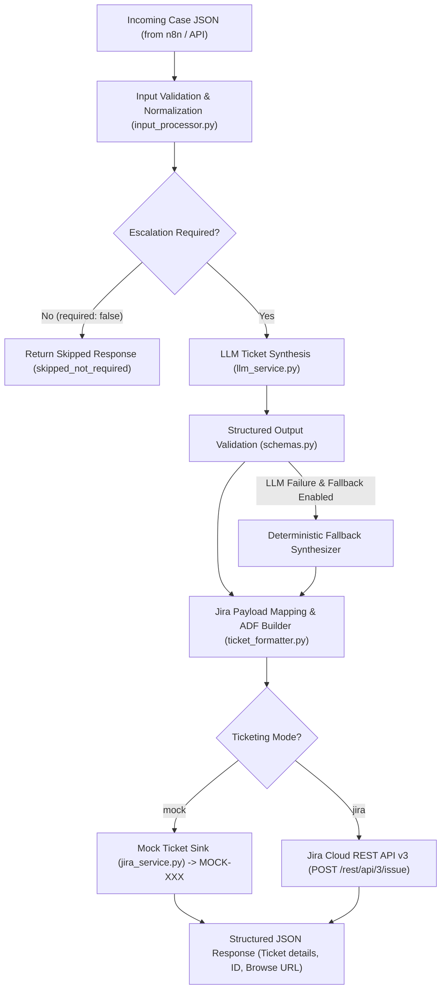

# Multimodal AI Automation for Internal IT Support: Escalation & Jira Ticket-Creation Workflow

> **University Final Project Component**  
> Synthesizes escalated IT incidents using an LLM and creates tickets in **Jira Cloud** (or simulates them via **Mock Mode**).

---

## 1. Project Context & Overview

This component is part of the **Multimodal AI Automation for Internal IT Support** system. The broader system receives user IT requests (optionally with screenshots or PDFs) and processes them through upstream components:
1. **Vision analysis:** Extracts terminal logs, dialog boxes, and OCR observations.
2. **Triage:** Categorizes the issue and assigns urgency (`critical`, `high`, `medium`, `low`).
3. **Retrieval/Diagnosis (RAG):** Retrieves relevant technical troubleshooting documentation.
4. **Resolution:** Evaluates automated troubleshooting steps and records user feedback.
5. **Escalation (This Component):** Receives the case once upstream determines human intervention is needed, synthesizes a factual ticket using an LLM, and creates the ticket in Jira Cloud.

The overall workflow is orchestrated by **n8n**. This component does **not** make independent escalation decisions; it faithfully executes the escalation decision and urgency level supplied by upstream.

---

## 2. Recommended Architecture & Pipeline



### Module Responsibilities

| File | Responsibility |
|---|---|
| `app.py` | FastAPI HTTP service exposing `/escalate`, `/health`, and `/format-preview` for n8n. |
| `config.py` | Environment variable management, credentials masking, and validation. |
| `schemas.py` | Pydantic v2 schemas for input contract, LLM output, and API responses. |
| `input_processor.py` | Validates JSON, enforces required fields, and normalizes optional values without hallucinating. |
| `llm_service.py` | LLM synthesis with system prompt enforcement, JSON mode, and deterministic fallback. |
| `ticket_formatter.py` | Converts synthesis into Jira Cloud payloads, including Atlassian Document Format (ADF). |
| `jira_service.py` | Jira Cloud REST API client with Basic Auth, HTTP error handling, and mock sink. |
| `workflow.py` | End-to-end pipeline coordinator. |
| `evaluate.py` | Evaluation runner scoring completeness, consistency, traceability, and priority. |

---

## 3. Installation & Quickstart

### Prerequisites
- Python 3.10+ (Tested on Python 3.13)
- pip

### 1. Install Dependencies
```bash
python -m pip install -r requirements.txt
```

### 2. Configure Environment Variables
Copy the template to create your `.env` file:
```bash
cp .env.example .env
```
*(On Windows PowerShell: `Copy-Item .env.example .env`)*

By default, `.env` runs in **Mock Mode** (`TICKETING_MODE=mock`, `LLM_PROVIDER=mock`), requiring zero external credentials.

### 3. Run the Automated Tests
```bash
python -m pytest -v
```

### 4. Run the Evaluation Suite
```bash
python evaluate.py
```

### 5. Run the End-to-End CLI Workflow
```bash
python workflow.py mock_input.json
```

### 6. Start the FastAPI HTTP Server
```bash
python app.py
```
Or with uvicorn directly:
```bash
uvicorn app:app --host 0.0.0.0 --port 8000 --reload
```
API Documentation will be available at: `http://localhost:8000/docs`

---

## 4. Operating Modes: Mock vs. Jira

You control the mode via the `TICKETING_MODE` variable in your `.env`:

### Mock Mode (`TICKETING_MODE=mock`)
- **Default mode** for offline development, grading, and unit testing.
- No network requests are made to Jira.
- Generates a simulated ticket identifier (e.g., `MOCK-001`) and mock URL (`https://mock.jira.local/browse/MOCK-001`).
- Preserves full input validation, LLM synthesis, and Jira payload formatting.

### Jira Mode (`TICKETING_MODE=jira`)
- Authenticates with your Jira Cloud instance via Jira REST API v3.
- Builds an Atlassian Document Format (ADF) description with structured headings, code blocks, bullet lists, and callout panels.
- Creates a real issue and returns the live issue key (e.g., `IT-104`) and browse URL.

---

## 5. Jira Cloud Setup Guide

To enable real ticket creation (`TICKETING_MODE=jira`), you must supply the following settings in `.env`:

```ini
TICKETING_MODE=jira
JIRA_BASE_URL=https://your-domain.atlassian.net
JIRA_EMAIL=your-email@example.com
JIRA_API_TOKEN=your_atlassian_api_token
JIRA_PROJECT_KEY=IT
JIRA_ISSUE_TYPE=Task
JIRA_API_VERSION=3
```

### How to obtain credentials:
1. **Atlassian API Token:**
   - Go to [Atlassian API Tokens](https://id.atlassian.com/manage-profile/security/api-tokens).
   - Click **Create API token**, label it (e.g., `it-escalation-agent`), and copy the token.
2. **Project Key:**
   - In Jira, open your target project (e.g. `IT Support` or `IT`).
   - The project key is the prefix used on ticket numbers (e.g., `IT` in `IT-101`).
3. **Issue Type:**
   - Standard issue types: `Task`, `Bug`, `Incident`, or `IT Help`.
   - Ensure the selected issue type is available in your Jira project.
4. **Permissions Required:**
   - The user account associated with `JIRA_EMAIL` must have the **Create Issues** permission in `JIRA_PROJECT_KEY`.

### Jira Priority Mapping
Upstream urgency is mapped to standard Jira Cloud priorities:
- `critical` → `Highest`
- `high` → `High`
- `medium` → `Medium`
- `low` → `Low`

---

## 6. LLM Configuration & Providers

The LLM is configured through environment variables:

| Variable | Values / Example | Description |
|---|---|---|
| `LLM_PROVIDER` | `mock`, `openai`, `gemini`, `custom` | Provider selection |
| `LLM_MODEL` | `gpt-4o-mini`, `gemini-2.5-flash` | Model identifier |
| `LLM_API_KEY` | `sk-...` | Provider API key |
| `LLM_BASE_URL` | *(optional)* | Custom OpenAI-compatible URL |
| `LLM_FALLBACK_ON_FAILURE` | `true` (default) | Uses deterministic factual formatter if API fails |

### Examples:
- **Google Gemini (Recommended for cost/speed):**
  ```ini
  LLM_PROVIDER=gemini
  LLM_MODEL=gemini-2.5-flash
  LLM_API_KEY=your_gemini_api_key
  ```
- **OpenAI:**
  ```ini
  LLM_PROVIDER=openai
  LLM_MODEL=gpt-4o-mini
  LLM_API_KEY=your_openai_api_key
  ```
- **Local Ollama / vLLM:**
  ```ini
  LLM_PROVIDER=custom
  LLM_MODEL=llama3.1
  LLM_BASE_URL=http://localhost:11434/v1
  LLM_API_KEY=ollama
  ```

---

## 7. Calling `/escalate` from n8n

### n8n HTTP Request Node Configuration:
- **Method:** `POST`
- **URL:** `http://localhost:8000/escalate` (or your server's host/container address)
- **Authentication:** None (or forward headers as configured in your network)
- **Send Body:** Yes
- **Body Content Type:** `JSON`
- **Specify Body:** `Using JSON`
- **JSON Payload:**
```json
{
  "case_id": "{{ $json.case_id }}",
  "user_request": "{{ $json.user_request }}",
  "vision_findings": {{ $json.vision_findings ? JSON.stringify($json.vision_findings) : "null" }},
  "triage": {{ $json.triage ? JSON.stringify($json.triage) : "null" }},
  "rag": {{ $json.rag ? JSON.stringify($json.rag) : "null" }},
  "resolution": {{ $json.resolution ? JSON.stringify($json.resolution) : "null" }},
  "escalation": {
    "required": {{ $json.escalation.required }},
    "reason": "{{ $json.escalation.reason }}"
  }
}
```

### Example Curl Command:
```bash
curl -X POST "http://localhost:8000/escalate" \
  -H "Content-Type: application/json" \
  -d @mock_input.json
```

### Example PowerShell Command:
```powershell
Invoke-RestMethod -Uri "http://localhost:8000/escalate" -Method Post -InFile "mock_input.json" -ContentType "application/json" | ConvertTo-Json -Depth 5
```

### Standard API Response Format:
```json
{
  "status": "success",
  "mode": "mock",
  "escalated": true,
  "case_id": "CASE-001",
  "reason": null,
  "ticket": {
    "id": "MOCK-001",
    "key": "MOCK-001",
    "url": "https://mock.jira.local/browse/MOCK-001",
    "title": "[Docker - Port conflict] Docker container fails to start...",
    "priority": "High",
    "category": "Docker",
    "summary": "Docker container fails to start because port 8080 is already allocated.",
    "attempted_actions": [
      "Checked the container logs (Status: failed)",
      "Attempted to restart the container (Status: failed)"
    ],
    "escalation_reason": "The documented troubleshooting steps did not resolve the issue.",
    "suggested_assignee_group": "IT Support",
    "labels": ["escalation", "multimodal-ai", "docker"],
    "created_at": "2026-10-18T00:00:00Z"
  }
}
```

---

## 8. Network Timeouts & Idempotency Safety

> [!WARNING]
> **Do not retry ticket creation blindly after an HTTP network timeout.**

When sending a `POST /rest/api/3/issue` request to Jira Cloud, a network timeout can occur *after* Jira successfully processes the request and creates the issue, but *before* the HTTP response packets reach your application.

If an automated retry loop blindly resends the ticket creation request, Jira will create a **duplicate ticket** for each attempt.

### Safe Handling Strategy:
1. When a timeout occurs, this service raises `JiraNetworkTimeoutError` and returns `status: "error"`.
2. The orchestrator (n8n) or technician should inspect Jira using JQL search by Case ID or summary (`summary ~ "CASE-001"`) before retrying.
3. Only retry if the issue search confirms no ticket was created.

---

## 9. Test Suite & Evaluation Results

All **36 tests** pass without requiring external API credentials:
```
tests/test_api.py (5 tests)
tests/test_input_processor.py (6 tests)
tests/test_jira_service.py (6 tests)
tests/test_llm_service.py (4 tests)
tests/test_scenarios.py (11 tests covering all 9 project scenarios)
tests/test_ticket_formatter.py (4 tests)
```

### Verification of the 9 Required Scenarios:
1. **Unknown error:** Zero RAG documents found; escalation reason preserved without recalculation.
2. **Failed resolution:** Troubleshooting steps and negative user feedback traced accurately.
3. **Critical incident:** Urgency `critical` preserved and mapped to Jira `Highest`.
4. **Optional data missing:** Handled gracefully with explicit "Not provided" placeholders.
5. **Escalation not required:** Ticket creation skipped (`status: "skipped"`).
6. **Malformed LLM output:** Handled safely via deterministic fallback or clear error.
7. **Jira failure:** 400 Bad Request, 401 Auth, 404, and timeouts caught and categorized.
8. **Successful mock run:** Returns `MOCK-XXX` ticket without external network calls.
9. **Successful Jira run:** Verified Jira REST v3 payload structure and ADF content.
